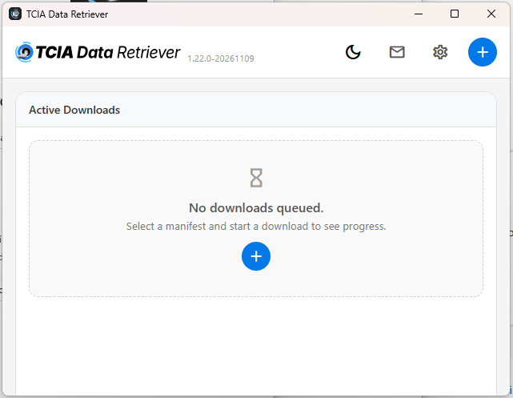
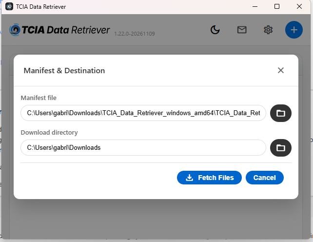

import { Steps } from '@astrojs/starlight/components';

## Background information

TCIA Data Retriever is the download tool of TCIA. It reads your manifest and downloads all the image series listed in it in one batch.

## To do

<Steps>

1. If it isn't installed on your computer yet, install [TCIA Data Retriever](https://wiki.cancerimagingarchive.net/display/NBIA/Downloading+TCIA+Images).

2. Open TCIA Data Retriever and click the blue **+** button:

   

3. In the **Manifest & Destination** window, use the folder buttons to choose:

   - **Manifest file:** the `.tcia` file you downloaded in section 2.2.
   - **Download directory:** a suitable folder for the data, for example a new, empty folder outside your code folder, such as `Desktop/tcia_data`.

   The picture below is only an example: your file name and folders will be different.

   

4. Click **Fetch Files**. If you are asked to accept a data usage agreement, accept it. You can follow the progress under **Active Downloads**.

5. While the download runs, continue with [2.4 Check the licence](/data/licence/).

</Steps>
