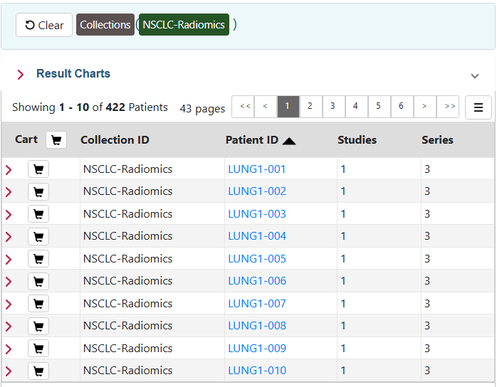

import { Steps } from '@astrojs/starlight/components';

## Background information

The full collection has 422 patients (about 36 GB). You only need a small cohort of 3 to 5 patients: enough to compare different scanners, without long downloads.

## To do

<Steps>

1. Open the [TCIA NBIA Search Portal](https://nbia.cancerimagingarchive.net/nbia-search/).
2. In the filter panel on the left, click the search icon (magnifying glass) next to **Collections** and type `NSCLC-Radiomics`. The list now shows the **Community** group: click its arrow to open it, and tick **NSCLC-Radiomics**. Don't tick NSCLC-Radiomics-Genomics or NSCLC-Radiomics-Interobserver1, which are different collections.

   

   The results table now lists the patients of the collection, 422 in total:

   

3. Open the **Images** tab of the filter panel and, under **Image Modality**, select **CT** to filter out the other modalities.
4. In the results table, look at the **Patient ID** column and select 3 to 5 different patients by hand, for example `LUNG1-002`, `LUNG1-014` and `LUNG1-085`.

   **Don't click Select All.** Pick subjects from different result pages, so your cohort includes different scanner vendors and slice configurations.

</Steps>
