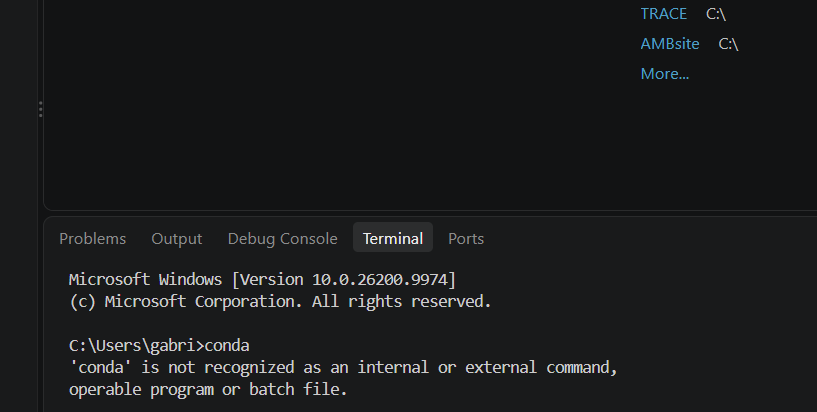

This page belongs to [1.4 Code editor (VS Code)](/environment/vs-code/). You only need it if you run into one of the problems below.

## conda is not recognized

You open a terminal in VS Code, type `conda`, and get this error:



In PowerShell, the default terminal in VS Code on Windows, the message reads: _The term 'conda' is not recognized as the name of a cmdlet, function, script file, or operable program_.

**Why it happens.** On Windows, the Anaconda and Miniconda installers don't make `conda` available in every terminal. Only the **Anaconda Prompt** is set up for it, and the VS Code terminal is a normal Command Prompt or PowerShell.

**How to fix it.** Use one of these two options.

- **Set up conda for all terminals (recommended, once).** Open the **Anaconda Prompt** from the Start menu and run:

  ```sh
  conda init cmd.exe powershell
  ```

  Close VS Code, open it again and open a new terminal. The prompt now starts with `(base)`, and `conda` works. If PowerShell shows an error that running scripts is disabled, run `Set-ExecutionPolicy -Scope CurrentUser RemoteSigned` once in that terminal and open a new one.

  You can also run this from the VS Code terminal itself, with the full path to conda in your [installation folder](#find-your-installation-folder): `<installation folder>\Scripts\conda.exe init cmd.exe powershell`.

- **Start VS Code from the Anaconda Prompt.** Close VS Code, open the Anaconda Prompt, go to your project folder with `cd` and type `code .`. Now `conda` works in the VS Code terminal, but you need to start VS Code this way every time.

## mie1004 is not in the interpreter list

- Click the refresh icon at the top right of the interpreter list, or close and reopen VS Code.
- If it is still missing, choose **Enter interpreter path** and enter the path to Python inside the environment. Find the environment's folder with `conda env list` (see [below](#find-your-installation-folder)), and add the Python executable to it:
  - **Windows:** `<environment folder>\python.exe`
  - **macOS and Linux:** `<environment folder>/bin/python`

  For example: `C:\Users\gabri\anaconda3\envs\mie1004\python.exe`

Don't use **Create Virtual Environment…** at the top of the interpreter list. It creates a new environment in a `.conda` folder inside your project, not the `mie1004` environment that these instructions use.

## Find your installation folder

Open the **Anaconda Prompt** (Windows) or a **Terminal** (macOS and Linux) and run:

```sh
conda env list
```

It lists all your conda environments and the folder of each one. For example:

```text title="Anaconda Prompt"
(base) C:\Users\gabri>conda env list

# conda environments:
#
base                 * C:\Users\gabri\anaconda3
MIE2003                C:\Users\gabri\anaconda3\envs\MIE2003
Skills2026             C:\Users\gabri\anaconda3\envs\Skills2026
TRACE                  C:\Users\gabri\anaconda3\envs\TRACE
amigo                  C:\Users\gabri\anaconda3\envs\amigo
ampy6                  C:\Users\gabri\anaconda3\envs\ampy6
ct2cbct                C:\Users\gabri\anaconda3\envs\ct2cbct
finad                  C:\Users\gabri\anaconda3\envs\finad
general                C:\Users\gabri\anaconda3\envs\general
kokoro                 C:\Users\gabri\anaconda3\envs\kokoro
skills                 C:\Users\gabri\anaconda3\envs\skills
survey_analysis        C:\Users\gabri\anaconda3\envs\survey_analysis
trace                  C:\Users\gabri\anaconda3\envs\trace
MIE2003                c:\Users\gabri\anaconda3\envs\MIE2003
```

- The `base` line shows the **installation folder**, in this example `C:\Users\gabri\anaconda3`.
- Every other line shows the folder of one environment, inside the `envs` folder of the installation. After section 1.2, your list also has a `mie1004` line, for example `C:\Users\gabri\anaconda3\envs\mie1004`.
- The `*` marks the environment that is active in this terminal.

If you can't run `conda` at all, look in the default locations on Windows:

- `C:\Users\<your user name>\anaconda3` or `C:\Users\<your user name>\miniconda3`, if you installed it just for yourself
- `C:\ProgramData\anaconda3` or `C:\ProgramData\miniconda3`, if you installed it for all users
